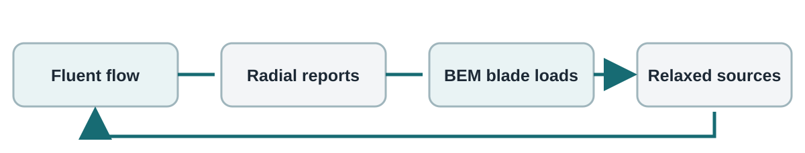
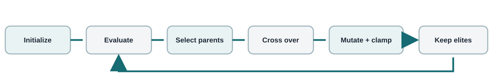

# OpTurbo Theory Guide

**Engineering ideas behind the geometry, mesh, CFD/BEM coupling, and search**
Companion theory reference for the axisymmetric 2D workflow · October 2026

This guide connects the equations and numerical models to the controls shown in the application. OpTurbo is a reduced-order design and analysis workflow. It combines a two-dimensional axisymmetric CFD domain and actuator-disk loads with a radial blade-element/momentum calculation. Its coefficients are useful for comparing candidates under a consistent setup; they are not, by themselves, a complete three-dimensional turbine certification.

## System overview {#theory-overview}

The workflow turns a bounded duct design into a numerical performance result. Geometry defines the domain and duct; meshing discretizes the flow region; Fluent solves conservation equations; BEM estimates blade loading along the rotor radius; the loads are written to the actuator-disk region and the two solvers iterate. The genetic algorithm changes selected design variables and maximizes one recorded objective.

The chain has feedback: BEM sources alter the Fluent flow; the updated velocity field changes BEM induction and blade loads. Outer iterations continue until Cp/Ct changes meet tolerance or the iteration budget ends. This coupling is why a mesh, fluid-property, blade-table, or initialization change can alter both the flow solution and the inferred loads.

## Duct profile representation: PARSEC {#theory-parsec}

PARSEC represents an upper or lower profile with a six-term half-power series:

`z(x) = sum(a_n * x^(n - 1/2)), n = 1 ... 6`

Here `x` is chordwise position normalized by chord and `z` is normalized ordinate. The coefficients are solved from geometric constraints such as leading-edge radius, crest position and height, crest curvature, and trailing-edge height and slope. Separate coefficient systems describe the two sides of a full airfoil; the flanged family uses its lower contour plus a flange construction.

The leading-edge radius chiefly constrains the square-root term, while crest constraints specify value, zero slope at the crest, and curvature. Trailing-edge constraints control the endpoint. The constraints yield a small linear system for the six coefficients. A solved parameter set can still produce a self-intersecting or physically unsuitable profile, so the application checks sampled profile validity and the user should inspect the preview.

Changing a normalized PARSEC ordinate is not a direct millimetre change. Chord length scales the normalized profile into the model. In the flanged family, flange dimensions and lower contour jointly determine the closed planar face. The FreeCAD exporter builds faces, so the volume-like 2D cross-section is represented as a closed region rather than a bare wire.

## Axisymmetric model and actuator disk {#theory-axisymmetric}

The meridional plane uses axial coordinate `x` and radius `r`. Rotating a meridional field around the axis corresponds to a three-dimensional annular flow while solving a two-dimensional model. This reduces computational cost but assumes circumferential symmetry: blade-to-blade details, discrete wakes, support struts, and nonuniform yaw are not resolved explicitly.

An actuator disk replaces individual blades with distributed momentum sources across a finite-thickness radial zone. BEM computes axial and tangential induction and maps integrated blade loading into the disk. Fluent resolves the surrounding pressure and velocity field, including the duct and hub boundaries. Disk thickness, radial span, location, rotor dimensions, and source distribution must therefore be mutually consistent.

## Conservation laws and CFD solution {#theory-cfd}

Fluent solves mass and momentum conservation with a selected turbulence closure. For steady incompressible flow, the continuity equation says that the net volumetric flow out of a small control volume is zero. Momentum balances convection with pressure, viscous stress, and actuator-disk forcing:

$$
div(u) = 0
$$

$$
rho * div(u tensor u) = -grad(p) + div(tau_eff) + S_AD
$$

Here `u` is velocity, `p` is pressure, `rho` is density, `tau_eff` represents molecular plus modeled turbulent stress, and `S_AD` is the momentum source from the actuator disk. This compact form summarizes the modeled equations; Fluent discretizes them over control volumes and includes the selected turbulence model's transport equations and boundary conditions. In axisymmetric swirl, Fluent also solves a circumferential velocity component even though the geometry and field remain independent of circumferential angle.

The numerical mesh approximates the continuous field with finite volumes. Each cell exchanges fluxes with its neighbors; residuals measure the remaining algebraic imbalance during iterative solution. Small residuals indicate that the discretized equations have been solved more closely, but do not prove that the mesh is fine enough or that the model is physically accurate. Compare mesh refinements and check stability of integrated outputs.

Pressure interpolation and pressure-velocity coupling control how pressure corrections enforce continuity. Momentum and turbulence discretization schemes approximate transport between cells. Higher-order schemes can reduce numerical diffusion when the solution is smooth, but may be less robust from a poor initial condition. Residual thresholds, schemes, and iteration counts work together; no single setting guarantees convergence.

## Boundary layers and mesh design {#theory-mesh}

Duct and hub walls create strong near-wall velocity gradients. Inflation layers place cells in a controlled stack normal to those walls so the solver can represent the boundary layer. Layer count and total maximum thickness determine the stack; growth rate controls expansion between adjacent cell sizes. Curvature sizing adds resolution where the profile bends sharply.

The resolution region concentrates cells around the rotor and duct flow, while global size controls more distant regions. Too coarse a mesh can smear pressure gradients and wakes; too fine a mesh raises cell count, memory, meshing time, and CFD time. Abrupt cell-size jumps can harm solution quality. A mesh study checks whether selected outputs are stable as the mesh changes. It should use the same geometry, operating point, turbulence model, and convergence criteria across cases.

Mesh convergence is assessed from a sequence of systematically refined meshes by comparing cell counts and outputs such as Cp, Ct, pressure drop, or local loads. Agreement between two meshes is evidence of reduced mesh sensitivity, not proof of model correctness. Distinguish mesh sensitivity from solver convergence: the former changes discretization, the latter reduces equation residuals on one fixed mesh.

## Blade element and momentum theory {#theory-bem}

BEM divides the blade span between hub and tip into radial stations. At each station, a blade element sees a relative velocity assembled from axial flow and rotation. Its inflow angle determines angle of attack after blade pitch and local twist are accounted for by the blade data. Bundled airfoil lift and drag tables supply sectional forces; blade count scales the forces into annular loads.

Momentum theory relates those loads to changes in axial and angular momentum through an annulus. The solver seeks axial induction `a` and tangential induction `a_prime` that make blade-element and momentum loads agree. Radial integration produces rotor thrust and torque. Induction factors describe the relationship between free-stream/rotation and the disturbed disk flow; their conventions should be read with the implementation and plotted distributions.

The GUI's radial station count sets discretization of the span. A low count may miss rapid root/tip changes; a higher count improves radial sampling but cannot fix incorrect blade tables or unsuitable loss corrections.

### The BEM equations used by this branch

At each radial station, OpTurbo reads the axial velocity `Ua` and tangential (swirl) velocity `Ut` reported by Fluent. The implementation infers the induction factors using its sign convention:

$$
a = 1 - Ua / U_inf;       a_prime = -Ut / (omega * r)
$$

The local axial and rotational velocity components, relative speed, and inflow angle are:

$$
Vx = U_inf * (1 - a);     Vtheta = omega * r * (1 + a_prime)
$$

$$
W = sqrt(Vx^2 + Vtheta^2);     phi = atan2(Vx, Vtheta)
$$

The code then forms the angle of attack and Reynolds number. `twist` comes from the blade table; the pitch value is added using the code's degree convention. The lift and drag coefficients are interpolated bilinearly in angle and Reynolds number, with table values clamped at the table limits.

$$
alpha = phi_deg - twist + pitch;     Re = rho * W * chord / viscosity
$$

Resolve lift and drag onto the rotor-normal and rotor-tangential directions. `F` is the selected tip/root loss factor; `B` is blade count; `t_AD` is the finite actuator-disk thickness used to convert a span load into a volume source.

$$
C_n = Cl * cos(phi) + Cd * sin(phi);     C_t = Cl * sin(phi) - Cd * cos(phi)
$$

$$
sigma = B * chord / (2 * pi * r)
$$

$$
q_n = -0.5 * rho * W^2 * sigma * C_n * F / t_AD
$$

$$
q_t =  0.5 * rho * W^2 * sigma * C_t * F / t_AD
$$

`q_n` and `q_t` are the station source densities produced by the code (N/m^3). The negative sign on `q_n` represents axial momentum removed from the fluid by a turbine. `sources_from()` supplies `q_n` and `-q_t` to Fluent: the swirl source is the equal-and-opposite reaction to rotor torque. The UDF interpolates these values radially onto cells inside the disk zone.

Radial integration uses station widths `dr` and axisymmetric annular area `2*pi*r*dr`. With the code's sign convention, positive reported rotor thrust is the negative of integrated axial fluid force. Torque multiplies the integrated tangential force by its moment arm `r`; power is `omega * torque`.

$$
T = -sum(q_n * 2*pi*r*dr*t_AD);     Q = sum(r * q_t * 2*pi*r*dr*t_AD)
$$

$$
P = omega * Q;     Cp = P / (0.5*rho*pi*R^2*U_inf^3)
$$

These equations describe the code's discrete station calculation and sign convention. The branch does not iterate a textbook closed-form BEM momentum equation in isolation: Fluent supplies the local velocities, and the BEM calculation maps those sampled velocities and blade polars to a new actuator source field.

## Tip and root losses {#theory-losses}

An ideal annular momentum model assumes a continuous actuator surface. A finite-blade rotor has concentrated tip vortices and a root region that contributes less effectively. Prandtl's loss factor approximates these finite-blade effects and reduces the ideal sectional loading near root and tip.

For a station at radius `r` and inflow angle `phi`, the Prandtl tip and root arguments in `bem.loss_factor()` are:

$$
f_tip = (N / 2) * (R - r) / (r * sin(phi));     f_root = (N / 2) * (r - R_hub) / (r * sin(phi))
$$

The Prandtl factors use `2/pi * acos(exp(-f))`. For the Bontempo option, the branch adjusts the tip argument by a duct-specific empirical multiplier `g`, but still uses the Prandtl root factor:

$$
lambda = omega * R / U_inf;     g = exp(A * (N * lambda - B)) + C
$$

$$
F_tip = (2/pi) * acos(exp(-g * f_tip));     F_root = (2/pi) * acos(exp(-f_root))
$$

$$
F = max(1e-4, F_tip * F_root)
$$

`N` is blade count and `R_hub` is hub radius. For the standard Prandtl option the tip factor also uses `exp(-f_tip)` without `g`. The code combines tip and root factors multiplicatively. The Bontempo coefficients are a duct-specific calibration; they should be treated as fitted model inputs, not universal constants for every rotor or duct.

Tip-speed ratio is `lambda = omega * R / U_inf`, where `omega` is angular speed, `R` rotor radius, and `U_inf` free-stream speed. It compares blade tip speed with incoming flow speed. Changing blade count or operating point changes lambda-related behavior, so fitted coefficients should not be transferred casually.

## Fluent and BEM coupling loop {#theory-coupling}

The coupling is a fixed-point iteration between a field solver and a reduced-order rotor model. Fluent solves the axisymmetric flow around the duct and disk for one source field. BEM then reads Fluent's sampled axial and swirl velocities at the configured radii, computes new radial blade loads, and converts them to source densities. Fluent and BEM therefore answer different parts of the same problem: CFD resolves the duct flow, while BEM supplies blade forces without modeling each blade in the mesh.

The actual loop in `workflows/axisymmetric_2d/cfd/coupling.py` performs these steps:

1. Create an initial axial and swirl source profile. The initial axial profile is smooth and negative, while the starting swirl source is positive; both scale with actuator thickness.
2. Write one `r, Sx, Sw` row per radial station, then run the Fluent journal. The UDF loads the file, linearly interpolates the station values in radius, and returns axial and swirl momentum sources to the corresponding velocity equations.
3. Read Fluent's facet-averaged axial and swirl velocities at the same radii. `bem.solve()` calculates induction, inflow angle, airfoil-table coefficients, losses, and updated loads.
4. Convert the blade loads into new source arrays. Relax each old/new pair before writing the source field for the next CFD solve.
5. Record each iteration's Cp, Ct, loads, and distributions. Stop when both Cp and Ct change by less than the configured tolerance, or when the outer iteration limit is reached.

The relaxed update for either component is:

$$
S_next = (1 - beta) * S_old + beta * S_BEM
$$

`beta` is the GUI relaxation fraction. For example, if `S_old = -100` N/m^3, `S_BEM = -160` N/m^3, and `beta = 0.25`, then `S_next = -115` N/m^3. Only one quarter of the difference is applied in this iteration. A smaller fraction damps source oscillations but takes more outer loops; a larger fraction can speed progress but can overshoot. The same blend is applied independently to axial and swirl sources.

There are two nested convergence processes. The Fluent inner iterations reduce the discretized flow-equation residuals for the current source field. The coupling outer iterations update the source field and track changes in Cp and Ct. Meeting a residual target on one mesh does not imply that the CFD/BEM fixed point has settled; stable outer Cp/Ct does not prove mesh independence either.

The code compares the current Cp and Ct to the previous outer iteration and stops when `max(abs(delta Cp), abs(delta Ct)) < tolerance`. The initial previous values are both zero, so the first iteration is compared with zero. The user-selected maximum outer iterations is a hard cap. Fluent iterations per outer pass are controlled separately.

Conservative initialization uses the generated starting source field. Previous-candidate initialization begins from the last successful candidate's final relaxed sources. This can accelerate nearby designs, but may carry a poor source pattern into a dissimilar candidate. A weight of zero is fully conservative and one is fully previous-source initialization. Early candidates fall back to conservative initialization because no prior result exists.

Previous-source reuse is accepted only when the saved radial station count and radii match the new blade data. The initial blend is `S_start = (1 - w) * S_conservative + w * S_previous`; an incompatible or missing source file falls back to conservative startup. It reuses only the actuator source guess, not a previous candidate's final velocity field.

## Performance coefficients and objectives {#theory-performance}

Power coefficient compares rotor power with kinetic power in a reference stream area:

`Cp = P / (0.5 * rho * A * U_inf^3)`

Thrust coefficient compares rotor thrust with dynamic pressure times area:

`Ct = T / (0.5 * rho * A * U_inf^2)`

Here `rho` is air density, `U_inf` is free-stream speed, `A` is the reference rotor area, `P` is power, and `T` is thrust. Cp and Ct are dimensionless. BEM distributions provide radial context for the integrated outputs; Cp/Ct alone can hide localized loading or convergence problems.

The application can also maximize Cp or Ct normalized by duct-tip area, based on the candidate's maximum duct radius. A normalization changes the denominator and thus the engineering question: an area-normalized value rewards performance per duct envelope area, while the default rotor-area coefficient compares against rotor swept area. Compare the same objective and normalization when ranking candidates. All four objectives are maximized; choosing Ct can favor thrust even if Cp falls.

## Genetic algorithm {#theory-optimization}

The optimizer in `src/opturbo/optimizer.py` is a real-valued genetic algorithm. An individual, also called a genome, is a mapping from each enabled design-variable key to one floating-point value. If three variables are enabled, an example genome could be `(duct_chord=..., duct_angle=..., upper_crest_height=...)`. Variables that are not enabled are not in the genome and remain fixed at their configured values. Each candidate is expensive because its fitness comes from the geometry, meshing, and CFD/BEM workflow.

### Generation 1: seed and evaluate

The first individual is the current baseline design, using each variable's configured value. The remaining `population_size - 1` genomes are sampled independently and uniformly between their lower and upper bounds. For a variable `x` in `[xmin, xmax]`, initialization is `x = uniform(xmin, xmax)`. Every genome is evaluated and assigned the selected objective value: Cp, Ct, or one of the duct-tip normalized variants. The implementation maximizes all four.

### Choose parents by tournament

To select one parent, the algorithm samples `k = min(tournament_size, population_size)` distinct individuals from the current population and returns the one with the highest fitness. Each parent selection is a new tournament. A larger tournament more strongly favors high-scoring individuals, which can make the population converge faster but reduces diversity. A tournament size of one is uniform parent selection.

### Recombine two parents

For each design variable independently, the algorithm draws a random number. With probability `crossover_rate`, it draws a blend weight `w` and computes an arithmetic blend. Otherwise it copies that variable from either parent with equal probability.

$$
x_child = w * x_parent1 + (1 - w) * x_parent2;     w uniform in [0, 1]
$$

This is real-valued recombination: a child can lie between its parents for that variable. Different variables use independent blend decisions and weights, so a child can combine geometry traits from both parents.

### Mutate and enforce bounds

For each child variable, mutation occurs independently with probability `mutation_rate`. The perturbation is Gaussian with a standard deviation scaled to that variable's full range, so units and numeric magnitudes do not dominate one another.

$$
x_proposed = x_child + Normal(0, (mutation_scale * (xmax - xmin))^2)
$$

The proposed value is clamped to its legal interval:

$$
x_next = min(xmax, max(xmin, x_proposed))
$$

Clamping keeps the genome within UI bounds. It does not guarantee that a shape within those bounds is geometrically valid; candidate validation and the engineering pipeline still decide whether it can be evaluated. Invalid candidates are recorded as failed evaluations by the workflow rather than silently turned into valid geometry.

### Elitism and next generation

After evaluating a generation, the population is sorted from highest to lowest fitness. The top `elite_count` individuals are copied unchanged into the next generation. The algorithm creates the remaining slots by repeatedly selecting two parents, producing a child, and appending it. Parent tournaments may select the same individual, and an individual may be selected more than once. When the last generation has been evaluated, the best individual seen across the full run is returned.

The loop can be summarized as:

$$
Next = Elites(top E) + Children(until population_size)
$$

where each child is generated by tournament selection, per-variable crossover, per-variable mutation, then bound clamping. A zero elite count means no candidate is automatically preserved. Elites preserve known good genomes but consume population slots that otherwise could explore new combinations.

### Small numerical example

Suppose one normalized variable lies in `[0, 10]`; parent values are `2` and `8`, `w = 0.25`, mutation scale is `0.10`, and mutation is selected. The crossover value is `0.25*2 + 0.75*8 = 6.5`. The mutation standard deviation is `0.10*(10 - 0) = 1.0`. If this random draw adds `0.4`, the proposal is `6.9`; clamping leaves it at `6.9`. A different Gaussian draw may move in either direction. With multiple variables, this process occurs separately for every variable.

### Reproducibility, cost, and resume

The random generator is initialized with the configured seed. Given the same settings and the same sequence of fitness results, it produces the same genomes. CFD can still vary slightly with external solver behavior, hardware, licenses, and convergence, so a repeatable random sequence is not a guarantee of identical physical results. Parallel candidate evaluation changes completion timing; the optimizer restores candidate-index order before processing results.

If all candidates finish and there is no resume cache, the nominal number of evaluations is:

$$
E_total = N + (G - 1) * (N - E)
$$

where `N` is population size, `G` is generation count, and `E` is elite count. This counts the first full population and then excludes carried elites from reevaluation in later generations. Every actual evaluation may launch several external engineering programs, so increasing population or generation count can multiply run time substantially. Resume regenerates the seeded genome sequence, checks saved candidate genomes against it, and reuses only matching saved results; this guards against continuing a run with a different search history.

Population size controls breadth per generation; generation count controls repeated search. Larger populations and more generations increase coverage and cost. Mutation rate and scale trade exploitation of promising regions against exploration. Too-narrow bounds can exclude useful shapes; too-wide bounds can generate invalid profiles and waste expensive evaluations. Validate geometry and establish reasonable limits before a large run.

A fixed random seed reproduces the evolutionary sequence for the same fitness outcomes. External CAD, meshing, and CFD software can still introduce small run-to-run numerical differences. GA optimization is stochastic search, not a proof of a global optimum. Repeat runs or use mesh/solver sensitivity checks when confidence matters.

## Mesh sensitivity, uncertainty, and interpretation {#theory-limits}

Predictions depend on geometry, dimensional assumptions, mesh, turbulence closure, blade polars, BEM implementation, loss correction, boundary conditions, convergence thresholds, and operating point. A well-converged numerical solve may still be biased by any of these modeling assumptions. Mesh independence only addresses one source of numerical uncertainty.

For credible comparisons, hold operating conditions and solver settings fixed; verify residual and coupling convergence; compare multiple mesh levels; inspect flow and radial loads; and preserve exact candidate configuration. Treat close rankings cautiously when their difference is smaller than observed mesh or solver sensitivity. Validate promising designs using a higher-fidelity three-dimensional analysis or experiment where appropriate.

## Units, symbols, and practical checks {#theory-reference}

Geometry coordinates and lengths: millimetres. Mesh element sizes and inflation thickness: centimetres. Rotor radius and flow inputs: metres, metres per second, kilograms per cubic metre, and pascal-seconds. Angular speed: radians per second. Profile, pitch, and curvature angles as labeled: degrees. Convert between millimetres, centimetres, and metres explicitly.

`x`: axial coordinate; `r`: radius; `U_inf`: free-stream speed; `omega`: rotor angular speed; `R`: rotor radius; `lambda`: tip-speed ratio; `a`, `a_prime`: axial and tangential induction factors; `Cp`: power coefficient; `Ct`: thrust coefficient; `rho`: density; `P`: power; `T`: thrust; `alpha`: source relaxation fraction.

Before trusting a ranking, check the profile preview, boundary clearance, duct/rotor alignment, unit consistency, mesh resolution, residual history, outer Cp/Ct stability, BEM loss-factor distribution, and saved candidate inputs. These checks explain what the model did; they do not remove the need for engineering validation.

## Further reading {#theory-references}

- H. Sobieczky, “Parametric Airfoils and Wings,” in *Recent Development of Aerodynamic Design Methodologies*, Vol. 65, edited by K. Fujii and G. S. Dulikravich, Vieweg+Teubner, 1999, pp. 71–87. DOI: 10.1007/978-3-322-89952-1_4. This describes PARSEC's physically meaningful profile parameters and coefficient-based curve representation.
- R. Bontempo and M. Manna, “Performance analysis of diffuser-augmented wind turbines through a CFD-based actuator disk method coupled with a Blade-Element approach,” *Energy Conversion and Management*, Vol. 342, article 120024, 2025. DOI: 10.1016/j.enconman.2025.120024. This study develops and validates a CFD actuator-disk/BEM method for diffuser-augmented turbines and motivates a duct-specific tip correction.

The equations and implementation details in this guide are matched to the OpTurbo source in this branch. The references give theoretical context; they do not imply that every model assumption or calibration in this application is identical to a published study.
